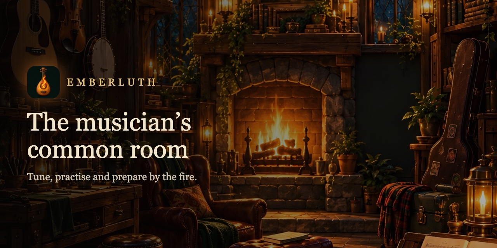
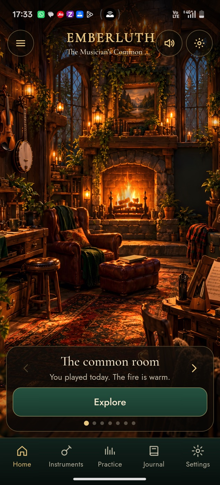
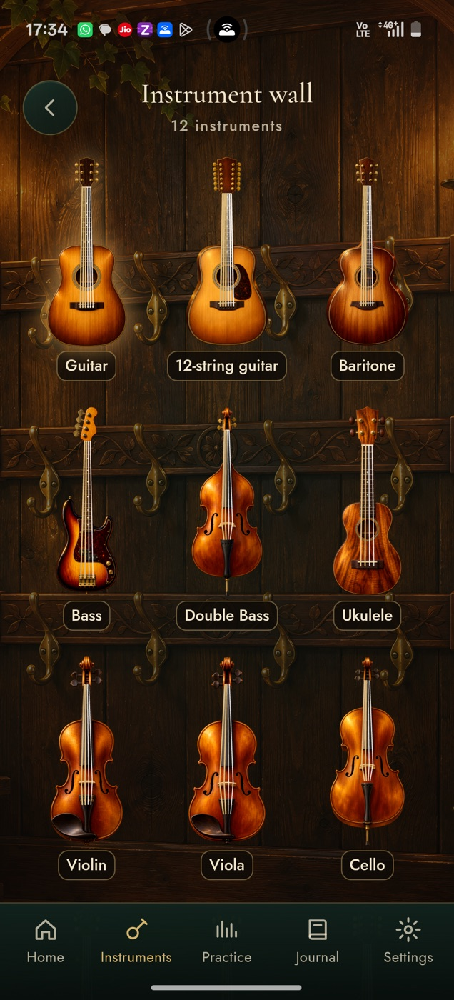
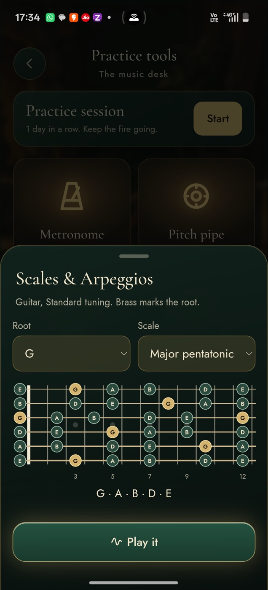
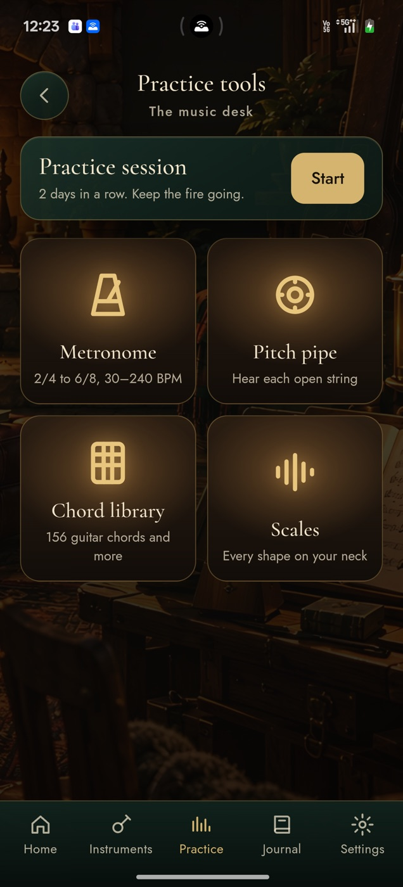

<h1 align="center">Emberluth</h1>

<b>The musician's common room.</b> Tune, practise and prepare by the fire.

Free · No ads · No tracking · Works offline · Android

Emberluth is a free, private app for string players, set in a living, painted common room. The fire breathes, candles
flicker, rain or snow taps the windows and the light follows your day. Swipe across the room to visit each place.

  
  
  
  

## What's inside

- **Tune** 12 instruments in 85 tunings: guitar, 12-string, baritone, bass, double bass, ukulele, violin, viola, cello,
  banjo, tenor banjo and mandolin. Auto, manual and chromatic modes, fine mode, headstock view, custom tunings,
  reference pitch from 415 to 466 Hz and a left-handed layout.
- **Practise** with a metronome, pitch pipe, 156 guitar chords, eleven scales and arpeggios on any fretboard, and a
  practice timer that logs every session.
- **Look after** your instruments with care guides, string-change records and notes, and keep a practice log with goals.

## Privacy

The tuner analyses sound on your phone and never records or sends it. No accounts, ads or analytics; everything you
write stays on your phone. Read the [privacy policy](https://h4r1-projects.github.io/emberluth/privacy.html).

## Status

Coming soon to Google Play. Website: https://h4r1-projects.github.io/emberluth/

© 2026 Harikrishnan B. All rights reserved. See [LICENSE](LICENSE).
